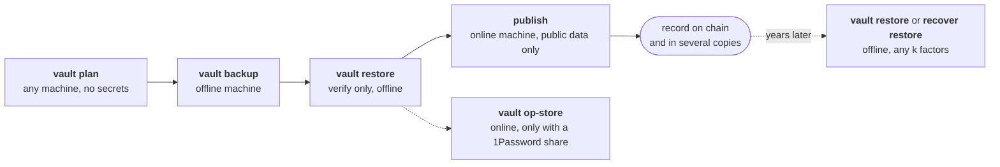

<div align="center">

# Ethereum Private Note

**Back up a wallet seed so that any *k* of *n* factors restore it, and fewer than *k* reveal nothing.**

A public record, a passphrase, a YubiKey and a paper share. The record can sit on any EVM chain, in your
email or on a printout: without enough factors it is noise.

[](https://github.com/TuDo1403/ethereum-private-note/actions/workflows/ci.yml)
[](https://github.com/TuDo1403/ethereum-private-note/actions/workflows/audit.yml)
[](https://github.com/TuDo1403/ethereum-private-note/releases)


[Quick start](#quick-start) ·
[How it works](#how-it-works) ·
[Install](#install) ·
[Making a backup](#making-a-backup) ·
[Restoring](#restoring) ·
[Security](#security-considerations) ·
[Limitations](#limitations)

</div>

> [!CAUTION]
> **Status.** Personal tool, not independently audited. The `publish` step has been tested against a
> local `anvil` chain only. Read [Limitations](#limitations) before trusting it with real funds.

---

## At a glance

Any **k of n** factors restore the seed; **fewer than k reveal nothing**. The usual setup, and the one
described below, is 2 of 3:

| | factor | what it is | where it lives |
|---|--------|------------|----------------|
| 📝 | **passphrase** | 12 BIP39 words, generated for you (132 bits) | paper |
| 🔐 | **YubiKey** | FIDO2 `hmac-secret` of a resident credential, unlocked by the key's PIN and a touch | the key |
| 📄 | **paper share** | 32 bytes written as 24 BIP39 words (looks like a seed, is not one) | paper |

The seed is encrypted with a random key, the key is split with Shamir, and the passphrase and YubiKey
shares are masked with pads derived from the passphrase and the YubiKey. The result is a 152-byte
**record** that is public by design: it can be stored on any EVM chain, emailed to yourself, printed, kept
in the cloud. Without two factors it is noise.

The format is k-of-n (2 <= k <= n <= 5; any number of hardware and paper shares, at most one passphrase share),
and `vault` makes any setup it allows: you choose the shares and k, for example 2 of 4 with two YubiKeys, and
`vault plan` scores the choice before you commit (see [Planning a setup](#planning-a-setup)).
`SPEC.md` describes the format completely (enough to write a recovery tool in another language) and
`vectors.json` fixes every intermediate value.

### The life of a backup



## Quick start

> [!TIP]
> Read [Recommended setup](#recommended-setup) first: the machine you use and where you keep each factor
> matter as much as the commands.

```bash
./vault plan                 # 1. design and score a setup (any machine, no secrets); writes setup.txt
./vault backup setup.txt     # 2. OFFLINE machine: make the backup; writes record.hex and recovery-sheet.txt
./vault restore              # 3. OFFLINE: pick "Verify only", try every combination of k shares
./publish <rpc-url> record.hex <refund-address>   # 4. ONLINE machine: store the public record on chain
./vault restore              # 5. when you need the seed: OFFLINE, any k factors
```

Install first: [prebuilt binaries](#prebuilt-binaries) or [from source](#from-source).

---

## Contents

- [Quick start](#quick-start)
- [How it works](#how-it-works)
- [Repository layout](#repository-layout)
- [Install](#install)
- [Recommended setup](#recommended-setup)
- [Planning a setup](#planning-a-setup)
- [Making a backup](#making-a-backup)
- [Publishing the record on chain](#publishing-the-record-on-chain)
- [Testing the backup](#testing-the-backup)
- [Restoring](#restoring)
- [Security considerations](#security-considerations)
- [Limitations](#limitations)
- [Development](#development)

---

## How it works

The picture is the 2-of-3 setup; other setups split K into more shares the same way.

```
seed entropy ──AES-256-GCM(K)──► ciphertext ─┐
                                              │
K ──2-of-3 Shamir──► y1 ──xor pad1──► masked ─┤
                     y2 ──xor pad2──► masked ─┼──► record (152 bytes, public)
                     y3 ──────────────────────┼──► paper share (24 words, paper)
                                              │
pad1 = HKDF(Argon2id(passphrase, 1 GiB, t=3, salt), header)
pad2 = HKDF(YubiKey hmac-secret, header)
```

- **Passphrase + YubiKey**: both pads unmask both shares, two shares give K.
- **Passphrase + paper share** or **YubiKey + paper share**: one unmasked share plus the paper share give K.
- AES-GCM authenticates the result, so a wrong factor is reported, never silently accepted.

The record header (version, Argon2 cost, salt, k, n, share kinds) is the AES-GCM associated data and is mixed
into every pad, so each record has its own pads even though the YubiKey's secret is the same for every
record.

## Repository layout

| path | what |
|------|------|
| `core/` (`epn-core`) | the format: Argon2id, HKDF, GF(2^8) Shamir, AES-GCM, BIP39 words, FIDO2 via libfido2 |
| `vault/` (`vault`) | interactive wizard: **plan** (design and score a setup, no secrets), **backup**, guided **restore**, and **op-store** (puts a 1Password share into 1Password) |
| `recover/` (`recover`) | small, scriptable **restore-only** tool; the one to keep for emergencies |
| `publish/` (`publish`) | online step: deploys the record as contract code from a throwaway gas key ([details](publish/README.md)) |
| `SPEC.md`, `vectors.json` | the backup format, and fixed test vectors for it |
| `vendor/` | every Rust dependency, pinned and vendored, so this builds offline years from now |

## Install

### Prebuilt binaries

Each [release](https://github.com/TuDo1403/ethereum-private-note/releases) has binaries for Linux
and macOS, x86_64 and aarch64. Take the installer from the release you want (it installs that same
release) and run it. It puts `vault`, `recover` and `publish` in `~/.local/bin` (set
`EPN_INSTALL_DIR` to change that):

```bash
curl -fsSL https://github.com/TuDo1403/ethereum-private-note/releases/download/vX.Y.Z/install.sh | sh
```

The installer checks the download against the release's `SHA256SUMS`. That catches a corrupt
download, not a tampered release, because both files come from the same place. To check that CI built
the binaries from this repository, download the tarball and run
`gh attestation verify epn-vX.Y.Z-<platform>.tar.gz --repo TuDo1403/ethereum-private-note`.
If you would rather not pipe a script into a shell, download the tarball and `SHA256SUMS` from the
release page and do the same checks by hand.

> [!TIP]
> For the machine that holds your backup, build from source (below): it avoids trusting a prebuilt
> binary at all.

### From source

Requirements:

- **Rust 1.100** (the tested toolchain; edition 2024).
- **libfido2 command-line tools** (`fido2-token`, `fido2-cred`, `fido2-assert`), needed whenever the
  YubiKey is used:
  - macOS: `brew install libfido2`
  - Debian/Ubuntu: `apt install fido2-tools`
- **Foundry** (optional): `cast` to read the record back from a chain, `anvil` for tests.
- On Linux, `publish` uses the system OpenSSL for https RPCs.

Build all three binaries from the vendored sources, no network needed:

```bash
cargo build --release --offline --locked
```

The binaries are `target/release/vault`, `target/release/recover` and `target/release/publish`.
Build on a trusted machine and copy them, together with this repository (or at least `SPEC.md`), to
the offline machine you will use.

## Recommended setup

### What you need

- **An offline machine.** Best: a laptop booted from a live OS (for example Tails) with networking
  disabled and no persistent storage. Acceptable: a machine you trust with wifi off and the cable
  unplugged for the whole session. It needs 2 GiB of free RAM (Argon2id uses 1 GiB).
- **A YubiKey 5 (or any FIDO2 key with `hmac-secret`) with a FIDO2 PIN set.** Set the PIN first, for
  example with `ykman fido access change-pin`. Without a PIN the key cannot be used.
  With more YubiKeys in the setup, you need one **physically different** key for each share.
- **Or 1Password with Touch ID** instead of a YubiKey: that share is then kept as a 1Password item and
  read back with Touch ID.
  - Install the `op` command and turn on *Settings > Developer > Integrate with 1Password CLI* in the
    1Password app.
  - This is a weaker factor than a YubiKey: the share syncs with your 1Password account and is as safe as
    that account, not tied to one device.
  - Use a **personal** account, never a work one (its admins can reach it, and you lose it with the job);
    `vault` asks for the account explicitly and passes it to every `op` call.
  - **Never keep the passphrase or the paper share in that same account**, or one breach of it gives two
    factors.
  - The `op` command needs 1Password's servers, so the offline backup never runs it: a 1Password share
    goes on a temporary paper and is put into 1Password afterwards, on your online machine, with
    `vault op-store`.
- **Paper and a pen** for the passphrase and the paper share. Steel plates if you want fire/water resistance.
- **An online machine** for `publish` (later, no secrets involved).
- **A wallet with a little ETH** on the chain you choose, to fund the throwaway publishing address.

### Where to keep things

The rule: **no single place holds k factors**, or one break-in opens the backup (for 2 of 3, no place holds
two). A suggested layout for 2 of 3:

| place | keeps |
|-------|-------|
| home safe | passphrase paper |
| on you / your desk | YubiKey (its PIN in your head or your password manager, never on the key), or the share in 1Password |
| second location (bank box, trusted family) | paper share, labelled *"backup share 3, not a wallet"* |
| anywhere, several copies | recovery sheet, `record.hex`, a printout of `SPEC.md` |

`vault plan` (see *Planning a setup*) checks a layout like this for you.

With 2 of 3, losing one factor is survivable: the other two still restore. Restore at once and make a new
backup, because you are now one loss away from losing the seed.

### Choosing a chain

The chain is one durable copy of the public record, not the only one. Pick one you expect to be
alive and readable for decades, with cheap storage of ~150 bytes. Any EVM chain works: the record is
stored as the code of a new contract, so nothing needs to be deployed on the chain beforehand.

## Planning a setup

```bash
./vault plan                    # or just ./vault and pick "Plan a setup (no secrets)"
```

`vault plan` asks for no secret and writes no secret, so it may run on any machine, online too. Use it to
try setups before you go offline. It walks through:

1. **Choose a setup.** A preset, or Custom (add shares one at a time, then choose k):
   - 2 of 3: passphrase, YubiKey, paper (the setup described in the rest of this file)
   - 2 of 3: passphrase, 1Password, paper
   - 2 of 4: passphrase, two YubiKeys, paper
   - 3 of 5: passphrase, two YubiKeys, two paper shares
   - Custom: any 2 to 5 shares and any k from 2 to n, with at most one passphrase share. A share is a
     passphrase, a YubiKey, a paper share or a 1Password share (account and vault are asked for).

   The shares are numbered in a fixed order, so the same setup always gets the same numbers: the passphrase
   first, then the YubiKeys, then the paper and 1Password shares.
2. **Labels.** Each share gets a neutral name ("YubiKey A", "paper B"); you may rename it. Labels are
   printed on the recovery sheet, which is public, so never put a place in a label (the review screen warns
   if one names a place you gave).
3. **Places.** For each share, say where it will be kept ("home safe", "office", ...), from the places you
   named so far or a new one.
4. **Review and score.** Two separate verdicts, using the places:
   - **Loss**, can you still restore after losing things. Weak if you can lose no share at all (n = k), or
     if one place holds more than n - k shares, so a fire there locks you out. Ok if you can lose any one
     share; strong if you can lose any two or more.
   - **Theft**, what the cheapest combination costs a thief. Weak if one place holds a whole combination
     of k shares, so one break-in opens the backup, or if a whole combination is 1Password shares in one
     account, so one breach of that account opens it (checked with or without places). Otherwise ok if
     some combination needs no YubiKey (a thief then needs the passphrase and a paper share, or a
     1Password account, from different places), and strong if every combination needs a YubiKey and its
     PIN (the key locks after repeated wrong PINs).

   Every warning names the exact combination and suggests a fix: move a share elsewhere, raise k, or add a
   share. The screen lists every combination of k shares that opens the backup. A weak setup is never
   refused, but you must type `yes` to use it; for any other setup you press Enter.
5. **Save.** `setup.txt` is written in the current folder (`setup-2.txt` and so on if one exists). It holds
   the labels, kinds, k and the 1Password accounts and vaults, and **never the places**: a file that says
   where every share lives is a map for a thief. The places are shown once, as a private "where things are"
   list, and are saved nowhere: write it down where a thief would not look, or remember it. The screen is
   cleared when you press Enter.

The scores only judge the places you typed; they cannot know whether you keep to them.
`vault backup setup.txt` re-checks the file as untrusted input (limits, labels, accounts), and shows only
the verdicts that need no places.

## Making a backup

On the **offline** machine, with the YubiKey (or, for several, the YubiKeys) at hand:

```bash
./vault backup setup.txt        # the setup made by `vault plan`
./vault backup                  # or just ./vault and pick "Make a new backup": choose the setup now
./vault backup --device PATH    # one YubiKey, when several FIDO2 keys are plugged in (see `fido2-token -L`);
                                # a setup with more than one YubiKey refuses --device
./vault backup --allow-unsafe-host   # only if you accept the host check's findings (see "The machine you use")
```

Without a file, `vault backup` runs the same setup, places and scoring screens as `vault plan` first, and
drops the places at once. With a file, it shows the setup and the verdicts that need no places (the places
were checked in `vault plan`), then asks you to accept it.

`vault` refuses to run through a pipe; it needs a real terminal. A plan file is checked before anything
else (a bad one is refused before a folder is made or a secret typed). Then it creates the output folder
`./backup-<timestamp>/` and checks that it can write there. The steps are numbered on screen ("i/N"); what
N is depends on the setup:

1. **Each YubiKey, one at a time.** For each YubiKey share, press Enter to create a new resident credential
   (PIN, then touch), or paste the credential id of one made earlier by `vault`. The id is not secret; it
   goes on the recovery sheet. With several YubiKeys, `vault` says "Plug in only YubiKey B": plug in just
   that key and press Enter, so that exactly one key is found (a setup with more than one YubiKey refuses
   `--device`). After the credential, its secret is read (PIN and touch). The keys come before the seed,
   so a missing key or a wrong PIN fails before you type anything.

   **Each YubiKey share must be a different physical key.** Otherwise a missed swap, or a pasted id that
   is really on an earlier key, would put two shares on one key, and the self-check would still pass. For
   every key after the first, `vault` asks for the PIN once more (no touch), lists the credentials on the
   key and refuses a key that holds an earlier share's credential ("this is the same key as YubiKey A")
   or lacks this share's. (For the first key, reading the secret already fails if a pasted id is not on
   it.) It also refuses a credential id used twice. This check relies on
   `fido2-token -L -k localhost`, and has not been run against a real YubiKey yet (see
   [Limitations](#limitations)).
2. **Seed.** Type your 12–24 seed words (hidden), then type them again: both entries must give the same
   seed, because a typo that is another BIP39 word passes the checksum surprisingly often (1 in 16 for
   12 words). The **seed fingerprint** (8 hex digits, see `SPEC.md`) is shown; note it. Only the entropy
   is stored; your BIP39 passphrase ("25th word"), if you use one, is **not** part of the backup.
3. **Passphrase** (if the setup has one). Twelve words are generated and shown once. Write them down in
   lowercase, one space between words. The screen is cleared and you must type them back.
4. **Build, check and save.** The YubiKey secrets were read at step 1; with a passphrase, Argon2id now
   stretches it (1 GiB, takes a while).
   **Every combination of k shares** is tried against the new record; if any combination fails, nothing
   is saved. Then the two public files, `record.hex` and `recovery-sheet.txt`, are written (and synced to
   disk) **before** any paper share is shown, so a crash later cannot leave you with papers and no
   record. If writing fails, `vault` says so: destroy the papers of that run and start again.
5. **Each paper and 1Password share, one at a time.** 24 words are shown once. Write them on a *separate*
   paper and label it *"backup share X, not a wallet"*. Then type all 24 back (hidden); a mismatch shows
   the share again so you can correct the paper. A 1Password share is shown the same way, but write it on
   a **temporary** paper labelled *"share X, for 1Password, destroy after `vault op-store`"*, kept apart
   from the other papers (any k shares restore the seed), and type it back. Nothing is sent to 1Password
   during the backup: the sheet names the item `epn-share-<X>-<record id>` that `vault op-store` creates
   later (see *Putting a 1Password share into 1Password*), and `vault restore` offers to read it from
   there instead of typing it.
6. **Next steps** are printed: test the papers with a verify-only restore, run `vault op-store` for each
   1Password share, publish the record, fill in the recovery sheet.

The recovery sheet has one line per share, in share order, naming it by number, kind and label, and how to
reach it, and never where it is kept. For example, for 2 of 4 with two YubiKeys:

```
share 1:  passphrase   "passphrase"
share 2:  yubikey      "YubiKey A"   credential <id>   (rpId localhost)
share 3:  yubikey      "YubiKey B"   credential <id>   (rpId localhost)
share 4:  paper        "paper"
```

A 1Password share's line ends with its `op://<vault>/<item>/password` reference and its account instead. The
sheet also holds the record id, the record, the seed fingerprint, blanks for the chain id and the
record's address, how to read and restore (including the `recover restore` command for this setup) and
"Any k of: ..." with the labels. Print it, together with `SPEC.md`, and keep a copy of it (or of
`record.hex` and these locators) in the storage place of every factor paper too.

Then clear the terminal scrollback, and shut down the offline machine (or reboot the live OS).

### Putting a 1Password share into 1Password

Only with a 1Password share, after the papers are tested (see *Testing the backup*). On your
**online** machine with the 1Password app, never the machine that saw the seed:

```bash
./vault op-store backup-<timestamp>/recovery-sheet.txt
```

It reads the account and item name from the sheet (public) and, when the sheet names several 1Password
shares, asks which one to store. It asks for that share from its temporary paper, twice, and stores it
(through stdin, never the command line or a file); 1Password asks for Touch ID. Before storing it checks
that the item does not exist yet; that check fails when the item is missing, but also when 1Password is
locked or offline, so it asks you to confirm in the 1Password app that the item is absent. It then reads
the item back and compares. Running it again finds the item instead of making a duplicate. Then
**destroy the temporary paper** (shred or burn it). Only that one share is ever typed on this machine;
run it again for each further 1Password share.

## Publishing the record on chain

On the **online** machine, copy only `record.hex` across (USB stick, QR, or retype it: it is public).
`vault` prints the command for it. `publish` pays from a throwaway key so the sending address is never
tied to your seed, and it sweeps leftover ETH back.

```bash
./publish [--verify-rpc URL] [--confirmations N] [--allow-high-fees] <rpc-url> <record.hex> <refund-address>
```

Missing arguments are prompted for. What happens:

1. A throwaway key is created **in memory only**; its address and an `ethereum:<address>@<chain id>?value=<wei>`
   URI are printed. Send that amount from your wallet (check the chain id in the wallet). It waits 15 min.
2. The record is deployed as the code of a new contract and read back.
3. Leftover ETH is swept to the refund address, on every exit after funding, including failures.
4. Chain id, the record's address and the record id are printed. **Write chain id and address on the
   recovery sheet** (the record id must match the sheet's).

Recommended flags:

- `--verify-rpc <url>`: read the record back from a second, independent node, so one lying RPC cannot
  claim a store that did not happen.
- `--confirmations <n>` (default 1): wait for more blocks before the read-back.

The refund address must start with `0x`, have a valid checksum if mixed-case, and be an EOA (no code), not the zero address.
Fee quotes over 500 gwei/gas or 0.5 ETH total are refused without `--allow-high-fees`. See
[`publish/README.md`](publish/README.md) for the full safety behaviour.

Afterwards, check from a node you trust:

```bash
cast code <address> --rpc-url <rpc>
```

The output must be `0x00` followed by the contents of `record.hex` (without its `0x`).

## Testing the backup

> [!IMPORTANT]
> **Do not trust a backup you have not restored.**

On the offline machine, right after making it, run `vault restore`, pick **Verify only** (the first,
default item), and restore with combinations of k shares until every share has been used at least once.
For 2 of 3, that is for example:

1. passphrase + YubiKey
2. passphrase + paper share
3. YubiKey + paper share

With a 1Password share, it is still on its temporary paper at this point: answer **no** when `vault`
offers to read it from 1Password (that needs the network) and type the paper. With several YubiKeys, `vault`
asks you to plug in one key at a time.

Verify only prints the seed fingerprint instead of the seed, so a test never puts your seed on screen.
It must equal the fingerprint on the recovery sheet. `vault` already checked every combination of k
against the in-memory values; this test checks what you actually **wrote on paper**.

Repeat a test every year or so, and whenever you move a factor, to find a smudged paper or a dead
YubiKey while you still have the other two.

## Restoring

You need the record (from the sheet, `record.hex`, or the chain) and any k factors (two, for 2 of 3). Do it
offline: the seed is printed on screen. Reading a 1Password share needs the network, so offline, open the
item in the 1Password app on another device and type its 24 words when `vault` asks.

### Guided: `vault restore`

```bash
./vault restore [--device PATH] [--allow-unsafe-host]
```

Pick **Verify only** (seed fingerprint, never the seed; the default) or **Restore** (shows the seed) with
the arrow keys and Enter. Paste the record
hex, or give the path to `record.hex` (a `recovery-sheet.txt` beside it supplies the share names, each
YubiKey credential id and each 1Password item; sheets made by earlier versions of `vault` still work).
Say which factors you have; the YubiKeys are asked first so a missing key or wrong PIN fails before you
type anything, one at a time ("plug in only YubiKey B") when you hold several; if a key cannot be read
(another key still plugged in, a wrong PIN), you are asked to plug it in again. A share kept in 1Password
is offered from 1Password (Touch ID); if that read fails, you are asked to type the paper instead. Paper
shares are entered word by word, the passphrase hidden. Three attempts. Verify only also lists any share
you held that was not needed, since any k shares open the record: test such a share in another run. This
is the normal way to restore: every secret is read at a hidden prompt.

### Scripted: `recover restore`

`recover` is deliberately small and reads secrets **only from stdin**, never from arguments, so they do
not land in `ps`. Run it alone, then type one factor per line and end with Ctrl-D:

```bash
./recover restore <record-hex> [--key X=CRED_ID[@PATH]]... [--device PATH] [--allow-unsafe-host]
```

```
pass <passphrase>        the passphrase: everything after the first space, not trimmed
paper <X> <24 words>     the paper share printed as share X
hw <X> <64 hex digits>   a hardware secret, instead of --key
```

`--key X=CRED_ID` asks the YubiKey that is share X for its secret (PIN and touch). With two or more
YubiKeys plugged in at once, give each key its own device as `--key X=CRED_ID@PATH` (`fido2-token -L`
lists the paths); a key without `@PATH` uses `--device`, else the only key found. A 1Password share is
typed as `paper X ...`. Every share has its number X on the recovery sheet, which also prints the exact
command for the backup (with `@<path>` placeholders when it has several YubiKeys). Input is visible on
screen, so mind the screen, but it never reaches shell history.

> [!WARNING]
> **Never type a factor into the command line itself**: your shell saves the whole line in its history file.

The seed words go to stdout, the shares used to stderr. Exit code 0 is success, 1 is a failed restore,
2 is a usage error. Errors never echo what you typed; a bad word is reported by its position or line.
See `SPEC.md` ("Restoring") for the exact rules.

If the recovery sheet is lost, the credential id can be listed from the key with its PIN:

```bash
fido2-token -L -k localhost <device>
```

### Without these tools

`SPEC.md` plus `vectors.json` are enough to rebuild the restore in any language. The building blocks
are standard: Argon2id, HKDF-SHA256, AES-256-GCM, Shamir over GF(2^8), BIP39. The YubiKey secret is the
same value a browser's WebAuthn PRF extension returns for rpId `localhost` and input `"bk1"`.

---

## Security considerations

### What each factor gives an attacker

| attacker holds | result |
|----------------|--------|
| the record only | nothing: masked or missing shares |
| record + any **one** factor | nothing about the seed, **but** see passphrase guessing below |
| record + any **k** factors (**two**, for 2 of 3) | the seed |

With k above 2, fewer than k factors still reveal nothing; testing a passphrase guess (see below) then
takes k - 1 other shares, not one.

The record is public, permanent and readable by anyone, forever. All confidentiality comes from the
factors.

### The passphrase is the weakest link, so it is generated

Anyone with the record and **one** of the paper share or the YubiKey (with its PIN) can test passphrase
guesses offline, for as long as they like. That is why the passphrase is generated (12 random words,
132 bits) and stretched with Argon2id at 1 GiB and 3 passes: brute force is far out of reach, even for a
quantum computer (Grover's search at best halves the bits, to about 66). Backups made with the older
7-word passphrase still restore. Do not
replace it with something you chose, and do not shorten it.

### A leaked factor cannot be revoked

The on-chain record is write-once and can never be deleted, and copies may exist anywhere.

> [!WARNING]
> If any single factor is exposed (paper photographed, YubiKey stolen together with its PIN, paper share
> seen), making a new backup does **not** help, because the old record stays attackable with that factor.
> **Move the funds to a new seed**, then back up the new seed.

### YubiKey

- Its PIN is the only thing between a thief of the key and its factor. Never store the PIN with the key.
  FIDO2 locks the key after repeated wrong PINs.
- The credential is tied to that physical key. It cannot be copied to a second YubiKey; a spare key
  does not replace a lost one (the other factors do, up to n - k lost shares). With several YubiKey
  shares, each must be its own physical key: two shares on one key are one factor, however many the
  setup counts. `vault backup` checks this as described under *Making a backup*.
- **Never reset the FIDO2 application** on the key (`ykman fido reset`): that destroys the credential,
  and its factor with it.
- The credential uses rpId `localhost`. Software on any machine the key is plugged into that can make
  you enter the PIN and touch the key can obtain the secret. Only enter the PIN and touch the key when
  `vault` or `recover` asks, on a machine you trust.

### The paper share looks like a wallet seed

It is 24 valid BIP39 words. Someone who finds it may import it as a wallet (it will be empty) and move
on, which is harmless, but you might also mistake it for your seed. Label it. Store it apart from the
passphrase and the YubiKey.

### The machine you use

No software here can beat a keylogger, a screen recorder or a kernel-level endpoint agent (CrowdStrike,
SentinelOne, Carbon Black and the like): whoever owns the kernel sees every key you type, the screen and
process memory. `vault` and `recover` therefore do two modest, heuristic things, and the rest is where you run them:

- **Host check.** They refuse to start while a network interface is up (loopback and link-local do not
  count) or a known monitoring agent is installed, and say which. `--allow-unsafe-host` continues anyway,
  with the findings printed as a warning. The agent list is a few install paths: finding nothing proves
  nothing. `vault plan` (no secrets) and `vault op-store` (the online step; it types only the one
  1Password share it stores) are exempt.
- **Process hardening.** No core dumps; other processes of the same user cannot attach a debugger or read
  the process (Linux `PR_SET_DUMPABLE`, macOS `PT_DENY_ATTACH`); on Linux all memory is locked out of swap
  when `RLIMIT_MEMLOCK` leaves room for Argon2's 1 GiB (run as root, or raise the limit). This stops crash
  collectors and same-user malware, **not root, and not an agent running in the kernel**. A failed step
  prints a warning.
- **Best fix: a machine that is never online and has no agent**: a spare laptop or a Raspberry Pi 4/5 booted
  from a read-only card, with no wifi. A managed work laptop is the wrong place for a seed.
- **Treat a real restore as burning the seed.** Prefer *Verify only*. If a restore showed the seed on a
  machine you do not fully trust, move the funds to a new seed afterwards.
- **Keep half the secret off the computer** if you sign with a hardware wallet: create the seed on the
  device and keep its own backup there, add a generated 12-word BIP39 passphrase (the "25th word") that you
  enter on the device's own screen, and back up *only that passphrase* with `vault` (as if it were a seed).
  A fully compromised computer then learns a passphrase that is useless without the device or its backup.
  Check that your device accepts a passphrase that long on its screen before relying on this.
- `vault` and `recover` need no network. Run backups and restores **offline**: the seed and secrets
  pass through memory and the screen.
- `vault` wipes seed, passphrase and key material from its memory after use (`zeroize`, best effort:
  copies made inside the format crate are not wiped), and the OS may still have paged memory to disk. A live OS without swap, or a machine with encrypted swap and
  hibernation off, avoids leaving copies on disk.
- Keep secrets out of anything that records the terminal: scrollback, screen recording, tmux logs,
  shell history, clipboard managers, screenshots syncing to the cloud. Clear the terminal afterwards.
- Never put secrets in a command line (as arguments, or inside a `printf ... | recover` pipeline) or
  `export` them in a shell whose history is saved. `recover` takes them on stdin for this reason; or use
  `vault restore`.
- Build from this repository's vendored sources (`--offline --locked`) on a machine you trust, and
  check you are running the binary you built.

### On-chain privacy

The record reveals that an address holds an Ethereum Private Note backup, the threshold and how many
shares exist. The throwaway sender holds nothing and is not derived from your seed, but **the
transaction that funds it links it to your wallet**, and the sweep links it to the refund address. If
you do not want your identity associated with a backup record, fund it from an address that is not
tied to you.

### The RPC node

`publish` sends only public data and transactions signed by the throwaway key, so an RPC cannot steal
a secret. It can censor or delay, quote inflated fees (bounded by the fee caps), or claim a store
succeeded when it did not. Use `--verify-rpc` with an independent node, and always re-check the record
with `cast code` against a node you trust before relying on it.

### Long-term recoverability

- Keep the record in several places besides the chain: the recovery sheet, email, cloud storage, and
  with each factor paper. Reading it from the chain needs the chain id and the record's address, which
  no factor can regenerate.
- Keep `SPEC.md` printed with the paper share, and keep a copy of this repository (with `vendor/`)
  somewhere durable. `recover` builds offline from it.
- The record carries a version byte; a future format must change it. Records of the earlier version 1
  are not read by these tools; the git tag `v1-final` holds the last tools that did.

## Limitations

- **Not independently audited.** Treat it as such.
- **`publish` has not been run against a real network yet**, only a local `anvil` chain. Do a full
  test run on a testnet before mainnet. Legacy (non-EIP-1559) chains are unsupported.
- **The different-key check has not been run against a real YubiKey yet.** `vault backup` refuses a second
  YubiKey share that is the same physical key as an earlier one by listing the credentials on the key
  (`fido2-token -L -k localhost <device>`), which needs a YubiKey with FIDO2 credential management; the
  tests only use fake keys. Until it has been tried on real hardware, confirm yourself that each YubiKey
  share is on its own key: list each key's credentials with its PIN (the command under
  [Restoring](#restoring)) and check that each credential id on the recovery sheet appears on exactly one key.
- The scores from `vault plan` only judge the places you type. They warn and never block.
- `recover` does not wipe secrets from memory after use (`vault` does).

## Development

```bash
cargo test --offline --locked     # unit, format vectors, CLI, and anvil end-to-end tests
cargo fmt --all --check
cargo clippy --workspace --all-targets --offline --locked -- -D warnings
cargo deny check                  # advisories, licences, sources (https://github.com/EmbarkStudios/cargo-deny)
```

CI (`.github/workflows/ci.yml`) runs these on Linux and macOS, x86_64 and aarch64, and also checks
that `vendor/` is exactly what `cargo vendor` produces from `Cargo.lock`. The toolchain is pinned in
`rust-toolchain.toml`. Commit messages follow [Conventional Commits](https://www.conventionalcommits.org)
(`type(scope): subject`, scopes in `.commitlintrc.yml`); the PR check enforces it.

### Releasing

All four crates share one version, `[workspace.package] version` in the root `Cargo.toml`.

1. In a PR, set that version, run `cargo build --offline` so `Cargo.lock` follows, and merge it.
2. Tag the merge commit and push the tag:

   ```bash
   git tag vX.Y.Z && git push origin vX.Y.Z
   ```

`release.yml` fails if the tag differs from the Cargo version. Otherwise it builds the binaries on
each platform and publishes them, `install.sh` (stamped with the tag) and `SHA256SUMS` as a GitHub
release with build provenance. "Run workflow" does the builds without publishing, as a dry run.

The test profile builds with `opt-level = 3` because the real-parameter vector runs Argon2id at
1 GiB. The anvil tests in `publish/` skip if `anvil` is not installed; the `vault` test skips if
`expect` is not installed.
